# LanFixer Comprehensive Architectural Function Map & Call Graph

Total Functions Analyzed: 302

## Function Master Table

| ID | Function Name | Lines | Purpose | Mutations | Locks Held | Timeouts Used |
|---|---|---|---|---|---|---|
| 1 | `Test-IsAdmin` | L298-L304 | ============================================================================== CORE HELPERS ============================ | None (Read-Only) | None | N/A |
| 2 | `Test-IsSystem` | L304-L308 | Core routine for Test-IsSystem | None (Read-Only) | None | N/A |
| 3 | `Write-Log` | L308-L336 | Every mutation goes through here: honest success/failure, dry-run support, counters. | None (Read-Only) | None | N/A |
| 4 | `Invoke-Change` | L336-L354 | Every mutation goes through here: honest success/failure, dry-run support, counters. | None (Read-Only) | None | N/A |
| 5 | `ConvertTo-ArgString` | L354-L373 | CommandLineToArgvW-correct quoting (the v2 version broke on a trailing backslash inside quotes). | None (Read-Only) | None | N/A |
| 6 | `Invoke-Native` | L373-L403 | Core routine for Invoke-Native | Native Exe | None | $TimeoutMs |
| 7 | `Get-SysExe` | L403-L406 | ---- state (Clixml, written atomically, lives in the ACL-locked store) -------- | None (Read-Only) | None | N/A |
| 8 | `Get-State` | L406-L427 | ---- state (Clixml, written atomically, lives in the ACL-locked store) -------- | None (Read-Only) | None | N/A |
| 9 | `Test-StateFile` | L427-L434 | True only for a file that exists AND deserialises to the hashtable the engine expects. | None (Read-Only) | None | N/A |
| 10 | `Save-State` | L434-L456 | Never write without the lock: a long-idle menu window would otherwise overwrite newer watchdog state | Files/Disk | None | N/A |
| 11 | `Get-SubTable` | L456-L462 | Core routine for Get-SubTable | None (Read-Only) | None | N/A |
| 12 | `Get-StateTime` | L462-L469 | Core routine for Get-StateTime | None (Read-Only) | None | N/A |
| 13 | `Set-StateTime` | L469-L470 | Core routine for Set-StateTime | None (Read-Only) | None | N/A |
| 14 | `Test-Elapsed` | L470-L473 | First-write-wins snapshot of the user's ORIGINAL value, so restore is exact. | None (Read-Only) | None | N/A |
| 15 | `Save-Original` | L473-L479 | First-write-wins snapshot of the user's ORIGINAL value, so restore is exact. | None (Read-Only) | None | N/A |
| 16 | `Get-DnsProfileName` | L479-L487 | 'ResetDHCP' is an ACTION, never a resting state: a value stored by an older build means the reset already ran, | None (Read-Only) | None | N/A |
| 17 | `Get-RouteProfileName` | L487-L499 | ============================================================================== | None (Read-Only) | None | N/A |
| 18 | `Repair-StoreChildren` | L499-L534 | Heals tampered ACLs on store children WITHOUT touching the vault: the old blanket "icacls \* /reset /T" ran on every ele | Native Exe | None | N/A |
| 19 | `Get-FileSha256` | L534-L551 | ---- optional per-institution override: <store>\config.json ------------------------------------- | None (Read-Only) | None | N/A |
| 20 | `ConvertTo-CfgOverride` | L551-L586 | ---- optional per-institution override: <store>\config.json ------------------------------------- Pure validator (unit-t | None (Read-Only) | None | N/A |
| 21 | `Test-ConfigFileTrusted` | L586-L600 | The file may only steer the tool when nobody but SYSTEM / Administrators owns or can write it. | None (Read-Only) | None | N/A |
| 22 | `Import-UserConfig` | L600-L614 | Core routine for Import-UserConfig | None (Read-Only) | None | N/A |
| 23 | `Get-ActivePortalUrl` | L614-L622 | Core routine for Get-ActivePortalUrl | None (Read-Only) | None | N/A |
| 24 | `Find-ActivePortalPort` | L622-L639 | Core routine for Find-ActivePortalPort | None (Read-Only) | None | N/A |
| 25 | `Test-PortalOnlineSmart` | L639-L646 | Core routine for Test-PortalOnlineSmart | None (Read-Only) | None | N/A |
| 26 | `Get-ActivePortalEndpoint` | L646-L659 | Core routine for Get-ActivePortalEndpoint | None (Read-Only) | None | N/A |
| 27 | `Get-ActiveCampusDns` | L659-L671 | Core routine for Get-ActiveCampusDns | None (Read-Only) | None | N/A |
| 28 | `Initialize-Store` | L671-L745 | SIDs, not names, so this works on any Windows language. | Native Exe | None | N/A |
| 29 | `Get-LanFixerMutex` | L745-L786 | ============================================================================== LOCKING (abandoned-mutex safe, cross-sess | None (Read-Only) | Mutex Direct | N/A |
| 30 | `Enter-Lock` | L786-L854 | Core routine for Enter-Lock | Files/Disk | Enter-Lock, Mutex Direct | WaitOne(1000), $TimeoutMs |
| 31 | `Exit-Lock` | L854-L870 | Core routine for Exit-Lock | Files/Disk | Mutex Direct | N/A |
| 32 | `Invoke-WithLock` | L870-L887 | Core routine for Invoke-WithLock | None (Read-Only) | Enter-Lock, Invoke-WithLock | N/A |
| 33 | `Test-InteractiveSessionActive` | L887-L908 | Core routine for Test-InteractiveSessionActive | Files/Disk | None | N/A |
| 34 | `Assert-Admin` | L908-L918 | ============================================================================== | None (Read-Only) | None | N/A |
| 35 | `Test-Ping` | L918-L926 | PROBES (all bounded by timeouts; no hangs on dead DNS or dead links) =================================================== | None (Read-Only) | None | $TimeoutMs |
| 36 | `Test-LatencySample` | L926-L932 | Core routine for Test-LatencySample | None (Read-Only) | None | $TimeoutMs |
| 37 | `Test-TcpPort` | L932-L961 | Parses the ANSWER section of a DNS response and returns ONLY IPv4 A records, in wire order. | None (Read-Only) | None | $TimeoutMs |
| 38 | `Get-DnsAAnswers` | L961-L1005 | - the transaction id must match the query, or a late answer to an earlier round is accepted as this one - QR must be set | None (Read-Only) | None | N/A |
| 39 | `Get-ScopedDnsAnswers` | L1005-L1073 | One raw UDP DNS query for ONE name, sent FROM a given local IPv4 address, answered only by that adapter's own configured | None (Read-Only) | None | Sleep -Milliseconds 2, $TimeoutMs |
| 40 | `Test-IsSinkholeIp` | L1073-L1090 | $SourceIp pins the lookup to ONE link: while a second uplink is up, the system-wide resolver answers from ITS DNS, so a  | None (Read-Only) | None | N/A |
| 41 | `Get-DnsVerdictDecision` | L1090-L1097 | Core routine for Get-DnsVerdictDecision | None (Read-Only) | None | N/A |
| 42 | `Get-AdapterDnsVerdict` | L1097-L1134 | Core routine for Get-AdapterDnsVerdict | None (Read-Only) | None | N/A |
| 43 | `Resolve-HostBounded` | L1134-L1173 | Pure (unit-tested): the absolute http(s) URL a captive page redirects to with <meta refresh> or JavaScript, else ''. | None (Read-Only) | None | $TimeoutMs |
| 44 | `Get-RedirectFromBody` | L1173-L1190 | Pure (unit-tested): the absolute http(s) URL a captive page redirects to with <meta refresh> or JavaScript, else ''. | None (Read-Only) | None | N/A |
| 45 | `ConvertFrom-HttpResponse` | L1190-L1214 | Plain HTTP/1.0 over a raw socket: hard timeouts everywhere, no proxy, no redirects followed, and the | None (Read-Only) | None | N/A |
| 46 | `Invoke-HttpProbe` | L1214-L1267 | Plain HTTP/1.0 over a raw socket: hard timeouts everywhere, no proxy, no redirects followed, and the socket can be bound | None (Read-Only) | None | $TimeoutMs |
| 47 | `Test-OtherUplinkActive` | L1267-L1275 | ============================================================================== CONNECTIVITY VERDICT (strict per adapter; | None (Read-Only) | None | N/A |
| 48 | `Test-AllowSystemFallback` | L1275-L1285 | Pure decision (unit-tested). The unbound/system probe exists for VPN/WARP/loopback-DNS setups. It would also happily ans | None (Read-Only) | None | N/A |
| 49 | `Get-AllWirelessAdapters` | L1285-L1293 | ============================================================================== INTERFACE METRICS (apply only while Ether | None (Read-Only) | None | N/A |
| 50 | `Get-OtherUplinkAdapters` | L1293-L1311 | Core routine for Get-OtherUplinkAdapters | None (Read-Only) | None | N/A |
| 51 | `Save-MetricOriginal` | L1311-L1321 | Core routine for Save-MetricOriginal | None (Read-Only) | None | N/A |
| 52 | `Set-InterfaceMetric` | L1321-L1328 | Remember every host route we create, so cleanup can remove addresses the configuration does not name. | IP Interfaces | None | N/A |
| 53 | `Add-TrackedHostRoute` | L1328-L1335 | Remember every host route we create, so cleanup can remove addresses the configuration does not name. | None (Read-Only) | None | N/A |
| 54 | `Remove-CampusHostRoutes` | L1335-L1360 | Ensure-CampusPortalPath also routes the discovered portal, the redirect target and each adapter's DHCP resolvers. | Routes | None | N/A |
| 55 | `Restore-InterfaceMetrics` | L1360-L1421 | records written by an older build: it never kept the original values, so automatic is the best honest restore | IP Interfaces | None | N/A |
| 56 | `Test-MetricsManaged` | L1421-L1429 | ============================================================================== | None (Read-Only) | None | N/A |
| 57 | `Get-Ipv6State` | L1429-L1437 | ============================================================================== IPv6: act only on EVIDENCE (advertised, b | None (Read-Only) | None | N/A |
| 58 | `Get-PreferIpv4Value` | L1437-L1444 | Pure decision (unit-tested): skip - candidate (seen once) - clamp (seen twice, within 8 bytes). | None (Read-Only) | None | N/A |
| 59 | `Get-MtuDecision` | L1444-L1457 | Pure decision (unit-tested): skip - candidate (seen once) - clamp (seen twice, within 8 bytes). | None (Read-Only) | None | N/A |
| 60 | `Get-DhcpErrorCode` | L1457-L1473 | Core routine for Get-DhcpErrorCode | None (Read-Only) | None | N/A |
| 61 | `Get-DhcpFailureText` | L1473-L1486 | ============================================================================== | None (Read-Only) | None | N/A |
| 62 | `Test-AllowedPortalIp` | L1486-L1499 | ============================================================================== HARDENED PORTAL CLIENT (raw TLS over a so | None (Read-Only) | None | N/A |
| 63 | `Test-PrivateIPv4` | L1499-L1511 | Pure decision (unit-tested). The real callback inlines the same rule: a delegate cannot see script functions. | None (Read-Only) | None | N/A |
| 64 | `Get-CertDecision` | L1511-L1519 | Pure decision (unit-tested). The real callback inlines the same rule: a delegate cannot see script functions. | None (Read-Only) | None | N/A |
| 65 | `New-CertCallback` | L1519-L1542 | A certificate is accepted ONLY when Windows validates it, or when its SHA-256 equals the pin you approved. $Capture (opt | None (Read-Only) | None | N/A |
| 66 | `ConvertFrom-ChunkedBytes` | L1542-L1574 | Bounded gzip / deflate (zlib or raw) decoder. A decompression bomb (> MaxBytes) or undecodable data returns the raw byte | None (Read-Only) | None | N/A |
| 67 | `Expand-HttpBody` | L1574-L1601 | Bounded gzip / deflate (zlib or raw) decoder. A decompression bomb (> MaxBytes) or undecodable data returns the raw byte | None (Read-Only) | None | N/A |
| 68 | `ConvertFrom-HttpBytes` | L1601-L1641 | One HTTPS exchange. Source-bound to the Ethernet IP, TLS 1.2, bounded time and size, no proxy, no auto-redirect. | None (Read-Only) | None | N/A |
| 69 | `Invoke-TlsHttp` | L1641-L1749 | One HTTPS exchange. Source-bound to the Ethernet IP, TLS 1.2, bounded time and size, no proxy, no auto-redirect. | None (Read-Only) | None | $TimeoutMs |
| 70 | `Get-HtmlAttr` | L1749-L1757 | First <form> that contains a password input. Returns hidden/submit fields, the user/password field names and the resolve | None (Read-Only) | None | N/A |
| 71 | `ConvertFrom-LoginForm` | L1757-L1840 | First <form> that contains a password input. Returns hidden/submit fields, the user/password field names and the resolve | None (Read-Only) | None | N/A |
| 72 | `Test-AclSidsOnly` | L1840-L1847 | ============================================================================== CREDENTIAL VAULT (machine-bound DPAPI + a | None (Read-Only) | None | N/A |
| 73 | `Protect-VaultFile` | L1847-L1853 | The vault must be readable by SYSTEM and Administrators ONLY, with inheritance cut. | Native Exe | None | N/A |
| 74 | `Test-VaultAcl` | L1853-L1864 | The vault must be readable by SYSTEM and Administrators ONLY, with inheritance cut. | None (Read-Only) | None | N/A |
| 75 | `ConvertFrom-VaultPlain` | L1864-L1870 | user<TAB>password, split on the FIRST tab only (a password may contain tabs). | None (Read-Only) | None | N/A |
| 76 | `Test-SameSubnetIPv4` | L1870-L1888 | Host routes that keep the campus portal and the campus resolver reachable over the UNAUTHENTICATED cable while | None (Read-Only) | None | N/A |
| 77 | `Ensure-CampusPortalPath` | L1888-L1934 | every other destination keeps using the working secondary uplink (Wi-Fi / Bluetooth / USB tethering). Called by the metr | Routes | None | N/A |
| 78 | `Get-PortalCertInfo` | L1934-L1946 | Pinning: only a certificate YOU looked at and approved is ever accepted when Windows does not trust it. | None (Read-Only) | None | N/A |
| 79 | `Format-Fingerprint` | L1946-L1955 | Pure decision (unit-tested). The old lock pinned whichever MAC answered first, so a spoofer already on the LAN was | None (Read-Only) | None | N/A |
| 80 | `Get-ArpDecision` | L1955-L1963 | stayed the same for 24 hours (a real router swap), and is flagged loudly until then. Pure decision (unit-tested): a gate | None (Read-Only) | None | N/A |
| 81 | `Get-WatchdogTask` | L1963-L1976 | Pure decision (unit-tested): does the registered task need to be written again? | Native Exe | None | N/A |
| 82 | `Test-WatchdogStale` | L1976-L1996 | Pure decision (unit-tested): does the registered task need to be written again? Wrong arguments = it runs an older copy. | None (Read-Only) | None | N/A |
| 83 | `Set-UiGlyphs` | L1996-L2019 | Switches the console into VT mode on older hosts. Never throws; false means "stay with 16 colours". | None (Read-Only) | None | N/A |
| 84 | `Enable-VtMode` | L2019-L2037 | Switches the console into VT mode on older hosts. Never throws; false means "stay with 16 colours". | None (Read-Only) | None | N/A |
| 85 | `Set-ConsoleQuickEdit` | L2037-L2052 | Ensure QuickEdit mode is always enabled and raw mouse capture is stripped so all console text is freely selectable | None (Read-Only) | None | N/A |
| 86 | `Initialize-Ui` | L2052-L2066 | Core routine for Initialize-Ui | None (Read-Only) | None | N/A |
| 87 | `Get-UiWidth` | L2066-L2072 | Core routine for Get-UiWidth | None (Read-Only) | None | N/A |
| 88 | `Get-UiHeight` | L2072-L2074 | Core routine for Get-UiHeight | None (Read-Only) | None | N/A |
| 89 | `ConvertTo-Role` | L2074-L2089 | A segment is a hashtable on purpose: nested arrays get flattened by @() when a line has a single segment. | None (Read-Only) | None | N/A |
| 90 | `Seg` | L2089-L2091 | A segment is a hashtable on purpose: nested arrays get flattened by @() when a line has a single segment. | None (Read-Only) | None | N/A |
| 91 | `Fit` | L2091-L2101 | Core routine for Fit | None (Read-Only) | None | N/A |
| 92 | `Get-SegsLength` | L2101-L2103 | Core routine for Get-SegsLength | None (Read-Only) | None | N/A |
| 93 | `ConvertTo-AnsiString` | L2103-L2116 | Core routine for ConvertTo-AnsiString | None (Read-Only) | None | N/A |
| 94 | `Out-Line` | L2116-L2131 | Core routine for Out-Line | None (Read-Only) | None | N/A |
| 95 | `Out-Rule` | L2131-L2136 | Redraws the whole screen in ONE write (no flicker, no scroll-back pollution). | None (Read-Only) | None | N/A |
| 96 | `Write-Frame` | L2136-L2149 | Redraws the whole screen in ONE write (no flicker, no scroll-back pollution). | None (Read-Only) | None | N/A |
| 97 | `Clear-Screen` | L2149-L2153 | Core routine for Clear-Screen | None (Read-Only) | None | N/A |
| 98 | `Show-Cursor` | L2153-L2157 | Ctrl+C needs no handler: PowerShell stops the pipeline and the try/finally in Start-Interactive restores the screen. | None (Read-Only) | None | N/A |
| 99 | `Enter-Screen` | L2157-L2163 | Ctrl+C needs no handler: PowerShell stops the pipeline and the try/finally in Start-Interactive restores the screen. (A  | None (Read-Only) | None | N/A |
| 100 | `Exit-Screen` | L2163-L2169 | One message, word-wrapped to the terminal with a hanging indent under the glyph (nothing is cut off). | None (Read-Only) | None | N/A |
| 101 | `Out-Wrapped` | L2169-L2180 | One message, word-wrapped to the terminal with a hanging indent under the glyph (nothing is cut off). | None (Read-Only) | None | N/A |
| 102 | `Test-InputRedirected` | L2180-L2182 | Thin wrappers so the interactive loop can be driven by scripted keystrokes in tests. | None (Read-Only) | None | N/A |
| 103 | `Test-KeyAvailable` | L2182-L2184 | Core routine for Test-KeyAvailable | None (Read-Only) | None | N/A |
| 104 | `Read-KeyNow` | L2184-L2186 | Core routine for Read-KeyNow | None (Read-Only) | None | N/A |
| 105 | `Clear-InputBuffer` | L2186-L2195 | ============================================================================== | None (Read-Only) | None | N/A |
| 106 | `Get-StateInfo` | L2195-L2209 | STATE MODEL (pure, unit-tested) ============================================================================== Maps the  | None (Read-Only) | None | N/A |
| 107 | `Get-StateRole` | L2209-L2214 | Greedy word wrap, at most $MaxLines lines (the last one is cut with an ellipsis). | None (Read-Only) | None | N/A |
| 108 | `Split-Words` | L2214-L2249 | Greedy word wrap, at most $MaxLines lines (the last one is cut with an ellipsis). | None (Read-Only) | None | N/A |
| 109 | `Update-Pulse` | L2249-L2274 | Returns $true when a new sample arrived. Never blocks. | None (Read-Only) | None | N/A |
| 110 | `Get-PulseModel` | L2274-L2302 | Pure: samples (-1 = lost) -> characters with roles plus summary numbers. | None (Read-Only) | None | N/A |
| 111 | `Get-PulseSegs` | L2302-L2328 | ============================================================================== | None (Read-Only) | None | N/A |
| 112 | `New-Telemetry` | L2328-L2339 | ============================================================================== TELEMETRY + ADVICE ====================== | None (Read-Only) | None | N/A |
| 113 | `Get-HopRows` | L2339-L2363 | Hop model for the stepper: label, value, state per hop. | None (Read-Only) | None | N/A |
| 114 | `Get-StepperLines` | L2363-L2396 | ============================================================================== | None (Read-Only) | None | N/A |
| 115 | `Get-LegendRows` | L2396-L2414 | DASHBOARD ============================================================================== Packs "key label" pairs into as | None (Read-Only) | None | N/A |
| 116 | `Get-DashboardModel` | L2414-L2592 | header | None (Read-Only) | None | N/A |
| 117 | `Update-PulseRow` | L2592-L2609 | Repaints only the pulse row (no flicker). VT consoles only, and only when the frame fits the window. | None (Read-Only) | None | N/A |
| 118 | `Show-View` | L2609-L2624 | ============================================================================== VIEWS AND MENUS ========================= | None (Read-Only) | None | N/A |
| 119 | `Read-Choice` | L2624-L2629 | Core routine for Read-Choice | None (Read-Only) | None | N/A |
| 120 | `Read-Confirm` | L2629-L2637 | Core routine for Read-Confirm | None (Read-Only) | None | N/A |
| 121 | `Show-Advisory` | L2637-L2686 | 1. Connection & Initial Setup | None (Read-Only) | None | N/A |
| 122 | `Show-VaultMenu` | L2686-L2791 | Core routine for Show-VaultMenu | None (Read-Only) | Invoke-WithLock | Sleep -Seconds 1, Sleep -Milliseconds 800, Sleep -Milliseconds 700 |
| 123 | `Start-Repair` | L2791-L2820 | Core routine for Start-Repair | None (Read-Only) | Invoke-WithLock | N/A |
| 124 | `Invoke-DashboardKey` | L2820-L3100 | The metric/DNS changes above are state even when the browser could not be opened: persist them | None (Read-Only) | Invoke-WithLock | N/A |
| 125 | `Get-PendingGatewayMacs` | L3100-L3113 | Approves ONE gateway at ONE MAC (the caller has already shown old/new and asked you to confirm). | None (Read-Only) | None | N/A |
| 126 | `Approve-GatewayMac` | L3113-L3132 | Approves ONE gateway at ONE MAC (the caller has already shown old/new and asked you to confirm). | None (Read-Only) | None | N/A |
| 127 | `ConvertFrom-PowerIndexText` | L3132-L3138 | Core routine for ConvertFrom-PowerIndexText | None (Read-Only) | None | N/A |
| 128 | `Get-ActivePowerScheme` | L3138-L3145 | Core routine for Get-ActivePowerScheme | Native Exe | None | N/A |
| 129 | `Get-PowerSettingIndex` | L3145-L3157 | Core routine for Get-PowerSettingIndex | Native Exe | None | N/A |
| 130 | `Set-UsbSuspendOff` | L3157-L3174 | Core routine for Set-UsbSuspendOff | Native Exe | None | N/A |
| 131 | `Restore-UsbSuspend` | L3174-L3184 | Core routine for Restore-UsbSuspend | Native Exe | None | N/A |
| 132 | `Get-ProbeVerdict` | L3184-L3194 | Core routine for Get-ProbeVerdict | None (Read-Only) | None | N/A |
| 133 | `Get-PrimarySourceIp` | L3194-L3202 | State: Online - Captive - NoDns - Offline  (+ Location of a captive redirect, when there is one) | None (Read-Only) | None | N/A |
| 134 | `Get-InternetState` | L3202-L3283 | State: Online - Captive - NoDns - Offline  (+ Location of a captive redirect, when there is one) | None (Read-Only) | None | Timeout = 2500 |
| 135 | `Test-GatewayAlive` | L3283-L3344 | Fresh evidence only: a cached neighbour entry proves nothing. 'Stale'/'Delay'/'Probe' are exactly what a DEAD gateway's  | ARP/Neighbors | None | Sleep -Milliseconds 100 |
| 136 | `Rescue-DormantEthernetPnp` | L3344-L3368 | ============================================================================== ADAPTERS / ENVIRONMENT / HEALTH ========= | Native Exe | None | N/A |
| 137 | `Get-EthernetAdapters` | L3368-L3374 | Core routine for Get-EthernetAdapters | None (Read-Only) | None | N/A |
| 138 | `Get-IfaceReg` | L3374-L3377 | Core routine for Get-IfaceReg | None (Read-Only) | None | N/A |
| 139 | `Get-DhcpDnsServers` | L3377-L3392 | Core routine for Get-DhcpDnsServers | None (Read-Only) | None | N/A |
| 140 | `Get-DhcpCaptiveUrl` | L3392-L3419 | Core routine for Get-DhcpCaptiveUrl | None (Read-Only) | None | N/A |
| 141 | `Get-GatewaysV4` | L3419-L3423 | Core routine for Get-GatewaysV4 | None (Read-Only) | None | N/A |
| 142 | `Get-DefaultGateway` | L3423-L3429 | Core routine for Get-DefaultGateway | None (Read-Only) | None | N/A |
| 143 | `Get-ValidIPv4` | L3429-L3438 | Scored fingerprinting. Strong evidence needs no network I/O (DHCP lease data survives APIPA), | None (Read-Only) | None | N/A |
| 144 | `Test-LearnableDhcpServer` | L3438-L3448 | Scored fingerprinting. Strong evidence needs no network I/O (DHCP lease data survives APIPA), and a sticky history stops | None (Read-Only) | None | N/A |
| 145 | `Get-AdapterEnvironment` | L3448-L3576 | Learned fingerprint: the DHCP server seen when the evidence was strong. Survives a changed DNS IP / suffix. | None (Read-Only) | None | N/A |
| 146 | `Get-AdapterHealth` | L3576-L3596 | Problem: NoAdapter - NoLink - NoIp - GwUnreachable - NoDns - Captive - Offline - Healthy | None (Read-Only) | None | N/A |
| 147 | `Wait-LinkSettling` | L3596-L3608 | Core routine for Wait-LinkSettling | None (Read-Only) | None | Sleep -Milliseconds 150 |
| 148 | `Test-WatchdogInstalled` | L3608-L3614 | ============================================================================== | Native Exe | None | N/A |
| 149 | `Reset-PhysicalAdapterHardware` | L3614-L3667 | ============================================================================== | NetAdapter, Native Exe | None | Sleep -Milliseconds 1000, Sleep -Milliseconds 1200 |
| 150 | `Test-NdisLinkHealth` | L3667-L3714 | LAYER 1 - HARDWARE, NDIS LINK HEALTH & POWER SHIELD ==================================================================== | None (Read-Only) | None | N/A |
| 151 | `Resolve-DuplexFlap` | L3714-L3750 | Core routine for Resolve-DuplexFlap | NetAdapter | None | N/A |
| 152 | `Optimize-PhySiliconBuffers` | L3750-L3808 | Core routine for Optimize-PhySiliconBuffers | NetAdapter | None | N/A |
| 153 | `Shield-TransceiverBus` | L3808-L3841 | Core routine for Shield-TransceiverBus | Native Exe | None | Sleep -Milliseconds 500 |
| 154 | `Shield-Aspm` | L3841-L3853 | Core routine for Shield-Aspm | Native Exe | None | N/A |
| 155 | `Get-NicClassKey` | L3853-L3861 | Core routine for Get-NicClassKey | None (Read-Only) | None | N/A |
| 156 | `Resolve-DisabledValue` | L3861-L3874 | Localized driver UI: only accept the unambiguous 0/1 pair for whitelisted keywords. | None (Read-Only) | None | N/A |
| 157 | `Shield-Hardware` | L3874-L3955 | "Allow the computer to turn off this device to save power" = PnPCapabilities DWORD 24 (0x18). | Registry, NetAdapter | None | N/A |
| 158 | `Shield-Dot3Svc` | L3955-L3987 | ============================================================================== LAYER 2 - DATA LINK: duplicate-address gu | Services, Native Exe | None | Sleep -Milliseconds 600 |
| 159 | `Wait-StpConvergence` | L3987-L4018 | Core routine for Wait-StpConvergence | None (Read-Only) | None | Sleep -Milliseconds 350, $MaxWaitSec |
| 160 | `Get-IPv4Interface` | L4018-L4020 | Core routine for Get-IPv4Interface | None (Read-Only) | None | N/A |
| 161 | `Get-DhcpFailureDiagnosis` | L4020-L4021 | Core routine for Get-DhcpFailureDiagnosis | None (Read-Only) | None | N/A |
| 162 | `Test-DhcpLeaseUsable` | L4021-L4028 | Core routine for Test-DhcpLeaseUsable | None (Read-Only) | None | N/A |
| 163 | `Repair-Dhcp` | L4028-L4111 | Step 1: release APIPA/stale state and renew with broadcast flag | Registry, ARP/Neighbors, Services, Native Exe | None | Sleep -Milliseconds 500 |
| 164 | `Test-DadConflictEvidence` | L4111-L4118 | Duplicate-address probes protect you from a REAL duplicate IP. They only hurt when the switch/ARP proxy answers every pr | None (Read-Only) | None | N/A |
| 165 | `Shield-DataLink` | L4118-L4230 | ============================================================================== | Routes, IP Interfaces | None | N/A |
| 166 | `Get-GatewayMacs` | L4230-L4256 | ============================================================================== LAYER 3 - GATEWAY ARP INTEGRITY (verify,  | ARP/Neighbors | None | Sleep -Milliseconds 100, Sleep -Milliseconds 150 |
| 167 | `Remove-GatewayLock` | L4256-L4266 | Retain the recorded MAC in $script:State.Arp so Get-ArpDecision can continue | ARP/Neighbors, Native Exe | None | N/A |
| 168 | `Release-ArpLocks` | L4266-L4272 | Core routine for Release-ArpLocks | None (Read-Only) | None | N/A |
| 169 | `Lock-GatewayArp` | L4272-L4277 | Core routine for Lock-GatewayArp | None (Read-Only) | None | N/A |
| 170 | `Shield-GatewayArp` | L4277-L4354 | Layer 3 Subnet Calculus & Adaptive PMTUD (Universal Zero-Hardcode Standard) | Routes, ARP/Neighbors, Native Exe | None | N/A |
| 171 | `Test-SubnetContainsIp` | L4354-L4367 | Layer 3 Subnet Calculus & Adaptive PMTUD (Universal Zero-Hardcode Standard) | None (Read-Only) | None | N/A |
| 172 | `Get-SubnetInfoFromLease` | L4367-L4430 | Core routine for Get-SubnetInfoFromLease | None (Read-Only) | None | N/A |
| 173 | `Find-OptimalPathMtu` | L4430-L4447 | Layer 3 Path MTU Clamping: Eliminates campus router blackhole drops on large TCP frames | None (Read-Only) | None | N/A |
| 174 | `Test-RouteViaAdapter` | L4447-L4454 | Layer 3 Path MTU Clamping: Eliminates campus router blackhole drops on large TCP frames Ping.Send cannot bind to an adap | None (Read-Only) | None | N/A |
| 175 | `Get-PathMtuForAdapter` | L4454-L4477 | Core routine for Get-PathMtuForAdapter | None (Read-Only) | None | N/A |
| 176 | `Shield-PathMtu` | L4477-L4513 | Layer 3 Route Shield: Verify reachability and prune unreachable duplicate default gateways | IP Interfaces | None | N/A |
| 177 | `Shield-DefaultRoutes` | L4513-L4544 | Layer 3 Route Shield: Verify reachability and prune unreachable duplicate default gateways | Routes | None | N/A |
| 178 | `Get-RouteMetricPlan` | L4544-L4575 | never gets the NITJSR /32 host routes pointed at a foreign router. The v4.5.1 bug was one compound condition ('not Campu | None (Read-Only) | None | N/A |
| 179 | `Shield-RouteMetrics` | L4575-L4627 | Branch 3 removes the campus host routes BEFORE promoting; branch 2 injects them AFTER demoting, so the | None (Read-Only) | None | N/A |
| 180 | `New-DnsQueryPacket` | L4627-L4642 | Real DNS-over-UDP probe, all servers in PARALLEL. | None (Read-Only) | None | N/A |
| 181 | `Measure-ResolversFast` | L4642-L4728 | - Round 1 gets 1.5x the budget (cold resolver cache); a blocked resolver costs ONE round; a refused one returns sooner.  | None (Read-Only) | None | Sleep -Milliseconds 2, $TimeoutMs |
| 182 | `Measure-Resolver` | L4728-L4732 | Core routine for Measure-Resolver | None (Read-Only) | None | N/A |
| 183 | `Get-BestDnsOrder` | L4732-L4762 | Core routine for Get-BestDnsOrder | None (Read-Only) | None | N/A |
| 184 | `Get-StaticDnsString` | L4762-L4767 | Core routine for Get-StaticDnsString | None (Read-Only) | None | N/A |
| 185 | `Set-AdapterDns` | L4767-L4791 | Core routine for Set-AdapterDns | Native Exe | None | N/A |
| 186 | `Set-AdapterDnsAutomatic` | L4791-L4808 | Only undo what WE changed (never wipe a static DNS the user set themselves). | Native Exe | None | N/A |
| 187 | `Restore-AdapterDns` | L4808-L4827 | Only undo what WE changed (never wipe a static DNS the user set themselves). | None (Read-Only) | None | N/A |
| 188 | `Restore-ManagedAdapterDns` | L4827-L4840 | and put back the user's exact pre-Lan Fixer value. Restore-AdapterDns only touches adapters marked managed, so an adapte | None (Read-Only) | None | N/A |
| 189 | `Get-OurNrptRules` | L4840-L4841 | Core routine for Get-OurNrptRules | None (Read-Only) | None | N/A |
| 190 | `Remove-CampusNrpt` | L4841-L4848 | Pure (unit-tested): does this lease look like the campus the built-in Cfg values describe? | None (Read-Only) | None | N/A |
| 191 | `Get-HomeCampusVerdict` | L4848-L4861 | Positive evidence: the configured campus resolver in the lease, a DNS suffix under the configured domain, or the configu | None (Read-Only) | None | N/A |
| 192 | `Set-CampusNrpt` | L4861-L4897 | Pure decision (unit-tested) for a NON-campus adapter whose profile is Adaptive/DHCP. | None (Read-Only) | None | N/A |
| 193 | `Get-OtherDnsAction` | L4897-L4904 | NoDns                                         -> Rescue     (network resolvers dead: substitute public ones) we already  | None (Read-Only) | None | N/A |
| 194 | `Test-DhcpDnsUsable` | L4904-L4913 | Do the network's own (DHCP-leased) resolvers answer right now? Probed from the adapter's own address so a second uplink  | None (Read-Only) | None | N/A |
| 195 | `Restore-Ipv6IfNeutralized` | L4913-L4926 | Core routine for Restore-Ipv6IfNeutralized | IP Interfaces | None | N/A |
| 196 | `Shield-DnsIntegrity` | L4926-L4956 | Core routine for Shield-DnsIntegrity | IP Interfaces | None | N/A |
| 197 | `Shield-DohFallback` | L4956-L4967 | Core routine for Shield-DohFallback | None (Read-Only) | None | N/A |
| 198 | `Shield-Dns` | L4967-L5062 | ============================================================================== | None (Read-Only) | None | N/A |
| 199 | `Shield-Portal` | L5062-L5085 | ============================================================================== LAYER 5 - CAPTIVE PORTAL REACHABILITY (th | None (Read-Only) | None | N/A |
| 200 | `Shield-Profile` | L5085-L5122 | ============================================================================== LAYER 6 - EXPOSURE: treat the hostel LAN  | Services | None | N/A |
| 201 | `Restore-LlmnrIfManaged` | L5122-L5133 | ============================================================================== LAYER 7 - SERVICES: NetBIOS chatter, NCSI | None (Read-Only) | None | N/A |
| 202 | `Invoke-RoamingCleanup` | L5133-L5177 | The hostel-only rules (campus-domain DNS rule, LLMNR off) are machine-wide, so they must not follow the laptop home. Cal | None (Read-Only) | None | N/A |
| 203 | `Restore-NeutralizedInterceptors` | L5177-L5207 | Core routine for Restore-NeutralizedInterceptors | Registry, Services | None | N/A |
| 204 | `Restore-Llmnr` | L5207-L5212 | LLMNR (like NetBIOS) lets any host on the hostel LAN answer "who is X?" and harvest credentials. Off on campus. | Registry | None | N/A |
| 205 | `Shield-Llmnr` | L5212-L5231 | LLMNR (like NetBIOS) lets any host on the hostel LAN answer "who is X?" and harvest credentials. Off on campus. | Registry | None | N/A |
| 206 | `Restore-Ipv6PrecedenceIfManaged` | L5231-L5242 | Core routine for Restore-Ipv6PrecedenceIfManaged | Registry | None | N/A |
| 207 | `Shield-Ipv6Precedence` | L5242-L5265 | Core routine for Shield-Ipv6Precedence | Registry | None | N/A |
| 208 | `Restore-NegCacheIfManaged` | L5265-L5276 | Core routine for Restore-NegCacheIfManaged | Registry | None | N/A |
| 209 | `Shield-NegCache` | L5276-L5294 | Core routine for Shield-NegCache | Registry | None | N/A |
| 210 | `Restore-MdnsIfManaged` | L5294-L5305 | Core routine for Restore-MdnsIfManaged | Registry | None | N/A |
| 211 | `Shield-Mdns` | L5305-L5324 | Core routine for Shield-Mdns | Registry | None | N/A |
| 212 | `Restore-SmartDnsIfManaged` | L5324-L5331 | Core routine for Restore-SmartDnsIfManaged | Registry | None | N/A |
| 213 | `Shield-SmartDns` | L5331-L5350 | CRITICAL MULTI-HOMING SAFETY: Smart Multi-Homed Name Resolution (SMHNR) MUST remain enabled. | Registry | None | N/A |
| 214 | `Restore-TcpKeepAliveIfManaged` | L5350-L5364 | Core routine for Restore-TcpKeepAliveIfManaged | Registry | None | N/A |
| 215 | `Shield-TcpKeepAlive` | L5364-L5385 | Core routine for Shield-TcpKeepAlive | Registry | None | N/A |
| 216 | `Shield-TcpAutoTuning` | L5385-L5397 | Core routine for Shield-TcpAutoTuning | None (Read-Only) | None | N/A |
| 217 | `Shield-TcpOffloads` | L5397-L5422 | Core routine for Shield-TcpOffloads | NetAdapter | None | N/A |
| 218 | `Shield-Proxies` | L5422-L5492 | Core routine for Shield-Proxies | Registry, Native Exe | None | N/A |
| 219 | `Shield-TransportProtocols` | L5492-L5540 | Core routine for Shield-TransportProtocols | Registry, Native Exe | None | 2000ms |
| 220 | `Shield-SystemStack` | L5540-L5795 | Pre-Guard: If unauthenticated Ethernet is up alongside an active Wi-Fi/secondary uplink, demote Ethernet metric first | Registry, Services, Native Exe | None | N/A |
| 221 | `Invoke-SupremeOmnifix` | L5795-L5908 | Lock is now released before the 180s human browser wait so background watchdog passes never block! | ARP/Neighbors, IP Interfaces, Services, Native Exe | Invoke-WithLock | N/A |
| 222 | `Invoke-UltraSystemReset` | L5908-L6318 | ============================================================================== ULTRA SYSTEM RESET - THE SUPREME HYPER-NU | Registry, ARP/Neighbors, IP Interfaces, NetAdapter, Services, Files/Disk, Native Exe | Invoke-WithLock | Sleep -Milliseconds 1500, Sleep -Milliseconds 1000 |
| 223 | `Invoke-DoomsdayReset` | L6318-L6837 | ============================================================================== DOOMSDAY SYSTEM RESET - THE SUPREME UNIVE | Registry, Routes, ARP/Neighbors, IP Interfaces, NetAdapter, Services, Files/Disk, Native Exe | Invoke-WithLock | Sleep -Milliseconds 1500, Sleep -Milliseconds 1000 |
| 224 | `Invoke-ArmageddonReset` | L6837-L6904 | ============================================================================== ARMAGEDDON SYSTEM RESET - KERNEL PROTOCOL | Registry, Native Exe | None | 5 sec |
| 225 | `Shield-Services` | L6904-L6981 | NCSI: only repair if something (a "tweak" tool) switched active probing off. | Registry, Services | None | Sleep -Milliseconds 500 |
| 226 | `Remove-LegacyHostsEntries` | L6981-L6998 | ============================================================================== LEGACY CLEAN-UP (v1 left hosts pins, manu | Files/Disk | None | N/A |
| 227 | `Invoke-LegacyMigration` | L6998-L7027 | v1 forced manual metrics 10/12/14/16/25 on adapters; hand them back to Windows. | Registry, IP Interfaces, Files/Disk, Native Exe | None | N/A |
| 228 | `Refresh-ContextAdapter` | L7027-L7036 | ============================================================================== THE PIPELINE ============================ | None (Read-Only) | None | N/A |
| 229 | `Invoke-HealPipeline` | L7036-L7162 | ============================================================================== | NetAdapter, Native Exe | None | Sleep -Milliseconds 500, Sleep -Milliseconds 600 |
| 230 | `Test-TrustedPortalHost` | L7162-L7178 | ============================================================================== PORTAL OPENING / LOGIN WATCH ============ | None (Read-Only) | None | N/A |
| 231 | `Get-SafePortalUrl` | L7178-L7189 | Returns the redirect URL only if it is an absolute http(s) URL on a campus-controlled host (no user-info tricks). Anythi | None (Read-Only) | None | N/A |
| 232 | `Resolve-PortalUrl` | L7189-L7211 | Dynamic first (survives a changed port / zone / path), configured anchor otherwise (already logged in, probe dropped, un | None (Read-Only) | None | N/A |
| 233 | `Test-CredentialPortalHost` | L7211-L7221 | attacker-controlled on a rogue LAN, so it must never decide where the saved password goes. Only the configured PortalHos | None (Read-Only) | None | N/A |
| 234 | `Get-CredentialPortalUrl` | L7221-L7231 | Core routine for Get-CredentialPortalUrl | None (Read-Only) | None | N/A |
| 235 | `Get-VaultEntropy` | L7231-L7240 | Core routine for Get-VaultEntropy | None (Read-Only) | None | N/A |
| 236 | `Save-PortalCredentials` | L7240-L7268 | Lock an EMPTY file first, write second: the secret never exists under a looser ACL. | Files/Disk | None | N/A |
| 237 | `Get-PortalCredentials` | L7268-L7288 | Core routine for Get-PortalCredentials | None (Read-Only) | None | N/A |
| 238 | `Remove-PortalCredentials` | L7288-L7302 | Zero-touch login. Every guard below exists because a rogue device on a hostel LAN can answer for the portal. | Files/Disk | None | N/A |
| 239 | `Invoke-HeadlessPortalLogin` | L7302-L7456 | Zero-touch login. Every guard below exists because a rogue device on a hostel LAN can answer for the portal. | None (Read-Only) | Invoke-WithLock | Sleep -Milliseconds 1000 |
| 240 | `Open-Portal` | L7456-L7490 | Core routine for Open-Portal | Native Exe | None | N/A |
| 241 | `Complete-Authentication` | L7490-L7509 | Post-login reconfiguration (metrics + DNS + state) is ONE transaction. Save-State refuses to write without the | None (Read-Only) | Enter-Lock, Invoke-WithLock | N/A |
| 242 | `Wait-ForAuthentication` | L7509-L7528 | Core routine for Wait-ForAuthentication | None (Read-Only) | None | Sleep -Milliseconds 120 |
| 243 | `Invoke-AuthWatch` | L7528-L7550 | ============================================================================== | None (Read-Only) | Enter-Lock | Sleep -Seconds 4 |
| 244 | `Test-HardFailure` | L7550-L7552 | ============================================================================== AUTONOMOUS RUN (called by the SYSTEM watc | None (Read-Only) | None | N/A |
| 245 | `Clear-FailStreakIfRecovered` | L7552-L7559 | A working connection ends the breaker no matter who repaired it (manual option 1, watchdog, or the cable just got better | None (Read-Only) | None | N/A |
| 246 | `Invoke-AutoHeal` | L7559-L7650 | ============================================================================== | None (Read-Only) | Enter-Lock | 20 sec |
| 247 | `New-WatchdogXml` | L7650-L7731 | ============================================================================== WATCHDOG (SYSTEM task, runs ONLY the ACL- | None (Read-Only) | None | N/A |
| 248 | `New-NotifyTaskXml` | L7731-L7780 | Core routine for New-NotifyTaskXml | None (Read-Only) | None | N/A |
| 249 | `Show-NativeToast` | L7780-L7792 | Core routine for Show-NativeToast | None (Read-Only) | None | N/A |
| 250 | `Invoke-RecoveryToast` | L7792-L7807 | Core routine for Invoke-RecoveryToast | Native Exe | None | N/A |
| 251 | `New-PortalTaskXml` | L7807-L7842 | Core routine for New-PortalTaskXml | None (Read-Only) | None | N/A |
| 252 | `Register-LfTask` | L7842-L7850 | Core routine for Register-LfTask | Files/Disk, Native Exe | None | N/A |
| 253 | `Install-Watchdog` | L7850-L7878 | Pure (unit-tested): schtasks /xml reports <Settings><Enabled>false</Enabled> for a task disabled in Task Scheduler. | Files/Disk | None | N/A |
| 254 | `Test-WatchdogDisabled` | L7878-L7882 | Pure (unit-tested): schtasks /xml reports <Settings><Enabled>false</Enabled> for a task disabled in Task Scheduler. | None (Read-Only) | None | N/A |
| 255 | `Get-WatchdogArguments` | L7882-L7887 | Core routine for Get-WatchdogArguments | None (Read-Only) | None | N/A |
| 256 | `Get-WatchdogExpectedArguments` | L7887-L7889 | A task registered by v1/v2.x runs an older copy. Re-point it once, automatically, at the current protected copy. | None (Read-Only) | None | N/A |
| 257 | `Update-WatchdogIfStale` | L7889-L7912 | A task registered by v1/v2.x runs an older copy. Re-point it once, automatically, at the current protected copy. | None (Read-Only) | None | N/A |
| 258 | `Uninstall-Watchdog` | L7912-L7933 | ============================================================================== | Native Exe | None | N/A |
| 259 | `Restore-Everything` | L7933-L8293 | ============================================================================== RESTORE: puts back YOUR snapshotted origi | Registry, Routes, IP Interfaces, NetAdapter, Services, Files/Disk, Native Exe | None | N/A |
| 260 | `Apply-DnsNow` | L8293-L8309 | Core routine for Apply-DnsNow | None (Read-Only) | None | N/A |
| 261 | `Set-DnsProfileMode` | L8309-L8336 | 1. Hand every adapter this tool substituted a resolver on back to the user's OWN value first. The managed | None (Read-Only) | Invoke-WithLock | N/A |
| 262 | `Set-RouteProfileMode` | L8336-L8375 | ============================================================================== | NetAdapter | Invoke-WithLock | N/A |
| 263 | `Write-FitText` | L8375-L8376 | UI HELPERS ============================================================================== ---- restyled helpers used by  | None (Read-Only) | None | N/A |
| 264 | `Write-Banner` | L8376-L8383 | Core routine for Write-Banner | None (Read-Only) | None | N/A |
| 265 | `Write-Section` | L8383-L8389 | Core routine for Write-Section | None (Read-Only) | None | N/A |
| 266 | `Write-KV` | L8389-L8395 | ============================================================================== | None (Read-Only) | None | N/A |
| 267 | `Get-PathMtu` | L8395-L8419 | ============================================================================== PATH MTU (confirmed twice, floor 1280, on | None (Read-Only) | None | N/A |
| 268 | `Test-Ipv6Reach` | L8419-L8434 | READ-ONLY AUDIT ============================================================================== TCP connect to well-known | None (Read-Only) | None | $TimeoutMs |
| 269 | `Get-Ipv6Verdict` | L8434-L8441 | Pure decision (unit-tested): the harmful case is "IPv6 advertised, IPv6 internet dead, IPv4 fine" - apps that try IPv6 f | None (Read-Only) | None | N/A |
| 270 | `Show-Diagnostics` | L8441-L8619 | ============================================================================== | None (Read-Only) | None | N/A |
| 271 | `Get-LatencyLabel` | L8619-L8625 | ============================================================================== QUICK PROBE (real numbers, real threshold | None (Read-Only) | None | N/A |
| 272 | `Run-QuickProbe` | L8625-L8682 | ============================================================================== | None (Read-Only) | None | Sleep -Milliseconds 120 |
| 273 | `ConvertTo-ReportText` | L8682-L8700 | FLUSH ============================================================================== Turns captured Write-Host output (i | None (Read-Only) | None | N/A |
| 274 | `New-SupportReport` | L8700-L8724 | Saves the full audit (adapters, MAC, lease, resolvers, events) plus the last log lines as a text file. Output is CAPTURE | Files/Disk | None | N/A |
| 275 | `Invoke-LogIntelligence` | L8724-L8759 | 1. Check Windows DNS Client Event 1014 (DNS resolution timeout in last 10 minutes) -> invalidate stale DNS speed cache | None (Read-Only) | None | N/A |
| 276 | `Flush-NetworkCache` | L8759-L8798 | ============================================================================== | ARP/Neighbors, Services, Native Exe | None | N/A |
| 277 | `Write-Check` | L8798-L8805 | Core routine for Write-Check | None (Read-Only) | None | N/A |
| 278 | `Invoke-LogicTests` | L8805-L9484 | Unit Test: DPAPI LocalMachine crypto round-trip | ARP/Neighbors, NetAdapter, Services, Files/Disk, Native Exe | Enter-Lock | N/A |
| 279 | `Invoke-SelfTest` | L9484-L9524 | ============================================================================== | ARP/Neighbors, IP Interfaces, NetAdapter | None | N/A |
| 280 | `Pick-Hash` | L9524-L9525 | ============================================================================== CONTROL CENTER (79 columns, ASCII only, a | None (Read-Only) | None | N/A |
| 281 | `Wait-AnyKey` | L9525-L9535 | Pure decision (unit-tested). The dashboard may only claim "Ethernet First" when the Ethernet adapter is really the | None (Read-Only) | None | N/A |
| 282 | `Get-RoutingLabel` | L9535-L9556 | Pure decision (unit-tested). The dashboard may only claim "Ethernet First" when the Ethernet adapter is really the lowes | None (Read-Only) | None | N/A |
| 283 | `Get-Telemetry` | L9556-L9636 | Headline, one plain sentence, and the single action Enter will run. | None (Read-Only) | None | N/A |
| 284 | `Get-Advice` | L9636-L9732 | Headline, one plain sentence, and the single action Enter will run. | None (Read-Only) | None | N/A |
| 285 | `Get-Sig` | L9732-L9736 | Core routine for Get-Sig | None (Read-Only) | None | N/A |
| 286 | `Show-Dashboard` | L9736-L9743 | Core routine for Show-Dashboard | None (Read-Only) | None | N/A |
| 287 | `Show-DnsMenu` | L9743-L9774 | Core routine for Show-DnsMenu | None (Read-Only) | None | N/A |
| 288 | `Show-RouteMenu` | L9774-L9806 | Core routine for Show-RouteMenu | None (Read-Only) | None | N/A |
| 289 | `Show-ResetMenu` | L9806-L9883 | Core routine for Show-ResetMenu | None (Read-Only) | None | N/A |
| 290 | `Write-HealSummary` | L9883-L9893 | ============================================================================== | None (Read-Only) | None | N/A |
| 291 | `Capture-PreflightSnapshot` | L9893-L9939 | ============================================================================== ACID STATE TRANSITIONS & AUTONOMOUS SENTI | None (Read-Only) | None | N/A |
| 292 | `Restore-PreflightSnapshot` | L9939-L9964 | Core routine for Restore-PreflightSnapshot | IP Interfaces | None | N/A |
| 293 | `Invoke-AcidMutation` | L9964-L10006 | Core routine for Invoke-AcidMutation | None (Read-Only) | None | Sleep -Milliseconds 250, $TimeoutMs |
| 294 | `Write-SentinelLog` | L10006-L10027 | Core routine for Write-SentinelLog | None (Read-Only) | None | N/A |
| 295 | `New-SentinelTaskXml` | L10027-L10084 | Core routine for New-SentinelTaskXml | None (Read-Only) | None | N/A |
| 296 | `Install-SentinelTask` | L10084-L10103 | Core routine for Install-SentinelTask | Native Exe | None | N/A |
| 297 | `Uninstall-SentinelTask` | L10103-L10115 | Core routine for Uninstall-SentinelTask | Native Exe | None | N/A |
| 298 | `Show-SentinelLogView` | L10115-L10138 | Core routine for Show-SentinelLogView | None (Read-Only) | None | Sleep -Seconds 2 |
| 299 | `Show-SentinelHud` | L10138-L10236 | Core routine for Show-SentinelHud | None (Read-Only) | None | N/A |
| 300 | `Wait-SentinelCadence` | L10236-L10282 | Core routine for Wait-SentinelCadence | None (Read-Only) | Invoke-WithLock | Sleep -Milliseconds 250, Sleep -Seconds 1 |
| 301 | `Start-AutonomousDaemon` | L10282-L10624 | Reactive NetworkChange event tracking via thread-safe polled transition detector | None (Read-Only) | Invoke-WithLock | N/A |
| 302 | `Start-Interactive` | L10624-L10914 | Core routine for Start-Interactive | Files/Disk | Invoke-WithLock | Sleep -Milliseconds 15, Sleep -Seconds 4, Sleep -Seconds 2 |

## Function Call Graph (Key Subsystems)

```mermaid
flowchart TD
    Invoke-SupremeOmnifix --> Write-Log
    Invoke-SupremeOmnifix --> Invoke-Change
    Invoke-SupremeOmnifix --> Invoke-Native
    Invoke-SupremeOmnifix --> Get-SysExe
    Invoke-SupremeOmnifix --> Save-State
    Invoke-SupremeOmnifix --> Invoke-WithLock
    Invoke-UltraSystemReset --> Write-Log
    Invoke-UltraSystemReset --> Invoke-Native
    Invoke-UltraSystemReset --> Get-SysExe
    Invoke-UltraSystemReset --> Save-State
    Invoke-UltraSystemReset --> Invoke-WithLock
    Invoke-UltraSystemReset --> Assert-Admin
    Invoke-DoomsdayReset --> Write-Log
    Invoke-DoomsdayReset --> Invoke-Native
    Invoke-DoomsdayReset --> Get-SysExe
    Invoke-DoomsdayReset --> Save-State
    Invoke-DoomsdayReset --> Invoke-WithLock
    Invoke-DoomsdayReset --> Assert-Admin
    Invoke-ArmageddonReset --> Write-Log
    Invoke-ArmageddonReset --> Invoke-Native
    Invoke-ArmageddonReset --> Get-SysExe
    Invoke-ArmageddonReset --> Save-State
    Invoke-ArmageddonReset --> Assert-Admin
    Invoke-ArmageddonReset --> Read-Confirm
    Start-Interactive --> Test-IsAdmin
    Start-Interactive --> Write-Log
    Start-Interactive --> Get-State
    Start-Interactive --> Save-State
    Start-Interactive --> Set-StateTime
    Start-Interactive --> Test-Elapsed
    Show-Dashboard --> Get-UiWidth
    Show-Dashboard --> Seg
    Show-Dashboard --> Out-Line
    Show-Dashboard --> Write-Frame
    Show-Dashboard --> Show-Cursor
    Show-Dashboard --> Get-DashboardModel
    Invoke-HeadlessPortalLogin --> Write-Log
    Invoke-HeadlessPortalLogin --> Save-State
    Invoke-HeadlessPortalLogin --> Set-StateTime
    Invoke-HeadlessPortalLogin --> Test-Elapsed
    Invoke-HeadlessPortalLogin --> Get-DnsProfileName
    Invoke-HeadlessPortalLogin --> Test-PortalOnlineSmart
    Shield-SystemStack --> Write-Log
    Shield-SystemStack --> Invoke-Change
    Shield-SystemStack --> Invoke-Native
    Shield-SystemStack --> Get-SysExe
    Shield-SystemStack --> Get-SubTable
    Shield-SystemStack --> Save-Original
    Shield-DataLink --> Write-Log
    Shield-DataLink --> Invoke-Change
    Shield-DataLink --> Get-SubTable
    Shield-DataLink --> Save-Original
    Shield-DataLink --> Test-Ping
    Shield-DataLink --> Test-GatewayAlive
    Shield-RouteMetrics --> Get-RouteProfileName
    Shield-RouteMetrics --> Get-AllWirelessAdapters
    Shield-RouteMetrics --> Get-OtherUplinkAdapters
    Shield-RouteMetrics --> Set-InterfaceMetric
    Shield-RouteMetrics --> Remove-CampusHostRoutes
    Shield-RouteMetrics --> Restore-InterfaceMetrics
    Shield-Dns --> Write-Log
    Shield-Dns --> Get-SubTable
    Shield-Dns --> Get-DnsProfileName
    Shield-Dns --> Get-DhcpDnsServers
    Shield-Dns --> Get-GatewaysV4
    Shield-Dns --> Get-ValidIPv4
```

